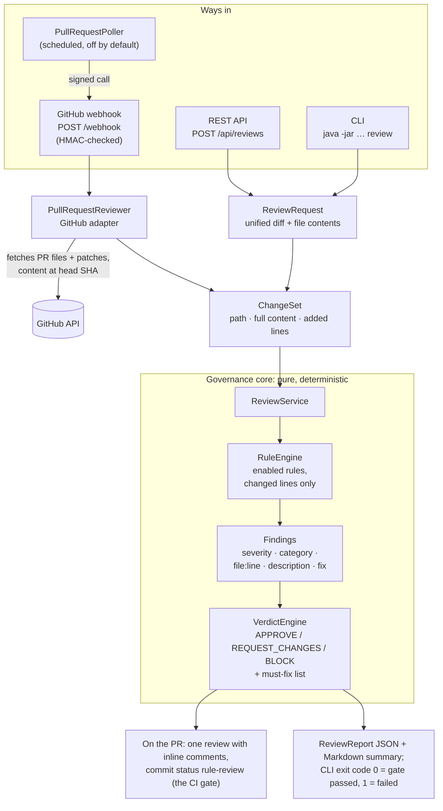
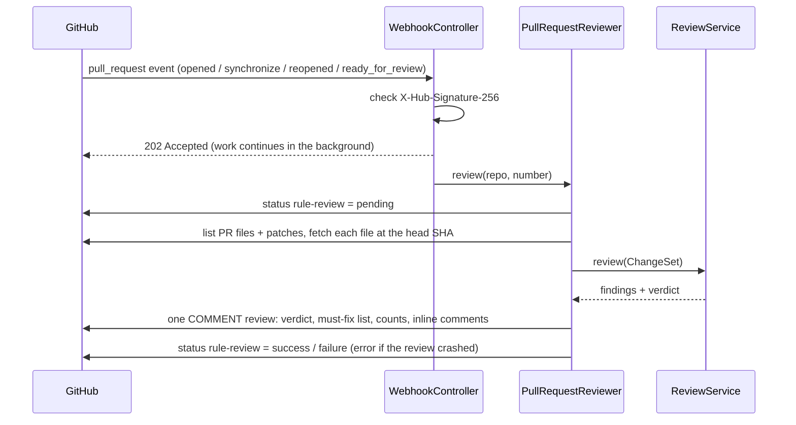

# Architecture

The bot is one Spring Boot application with no AI and no database. Every way in
(GitHub webhook, poller, REST API, CLI) turns the change into the same `ChangeSet` and runs the
same `ReviewService`, so a sample diff on a laptop gets the verdict it would get on a real PR.

## Components

`architecture.png` is this diagram rendered as an image, for slides. Regenerate it after changing the
diagram: `npx @mermaid-js/mermaid-cli -i diagram.mmd -o docs/architecture.png -b white -w 1000`.

| Package | Role |
|---|---|
| `github` | `WebhookController` (verifies the HMAC signature, answers within GitHub's timeout, reviews in the background), `PullRequestReviewer` (fetches the PR, posts the review and the status) |
| `poller` | `PullRequestPoller`: finds open PRs that have no verdict yet and sends them to `/webhook`, signed like GitHub would |
| `api` | `ReviewApiController`: `POST /api/reviews` for a diff plus file contents. Never calls GitHub |
| `cli` | `ReviewCli`: `review` and `request` commands, same beans and `application.yml` as the server |
| `review` | `ReviewService` (the workflow), `ChangeSet`, `ReviewRequest`, `UnifiedDiff` (splits a multi-file diff), `DiffParser` (added lines, diff positions), `ReviewReport` (JSON output) |
| `rule`, `rule.impl` | `Rule` interface, `RuleEngine`, `Finding`, and the rules themselves |
| `verdict` | `VerdictEngine` (findings to verdict), `VerdictProperties` (policy from `review.verdict`), `VerdictFormatter` (Markdown and status line) |
| `config` | `ReviewProperties`, `PollerProperties`, `GitHubConfig` |

## One review on GitHub

## Design decisions

- **Changed lines only.** Rules look at the whole file (they need the full AST), but the engine keeps
  findings only on lines the change added. Legacy issues don't block unrelated PRs.
- **Deterministic.** No AI, clock or randomness in the core. Findings are sorted (most severe first,
  then path, line, rule), so the same change always gives the same report, byte for byte.
- **Inputs are checked, not trusted.** A diff whose file content is from another version is rejected
  (findings would land on wrong lines). Text that isn't a diff is rejected instead of approved. The CLI
  won't read outside `--source`. `/webhook` rejects everything while no secret is set.
- **The gate is the commit status.** A PAT can't APPROVE or REQUEST_CHANGES its owner's own PRs, so
  the review is a COMMENT and the `rule-review` status enforces the verdict through branch protection.
